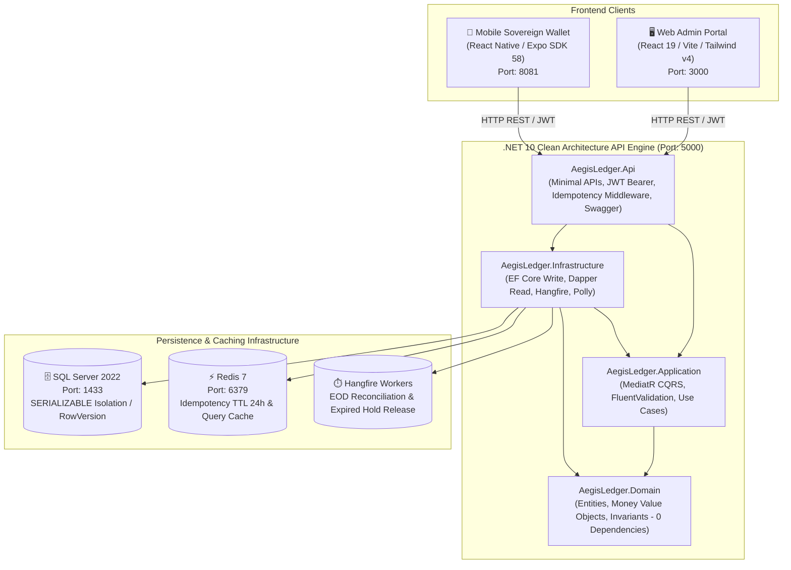

# 🏛️ AegisLedger v1.0
### Enterprise Core Banking & Immutable Double-Entry General Ledger System

[](https://dotnet.microsoft.com/)
[](https://react.dev/)
[](https://reactnative.dev/)
[](https://expo.dev/)
[](https://www.microsoft.com/sql-server/)
[](https://redis.io/)
[-brightgreen)](https://github.com/)
[](LICENSE)

---

## 📌 Executive Summary & System Vision

**AegisLedger v1.0** is an enterprise-grade Core Banking and Double-Entry General Ledger System designed based on strict financial engineering standards. It enforces immutable transaction integrity, multi-account solvency, and zero-drift balance consistency across commercial banking, treasury, escrow, and retail operations.

Modern fintech and core banking systems require mathematical certainty: **money cannot be created or destroyed**, available liquidity must be strictly ring-fenced from book balances, and concurrent ledger transactions must execute with strict serializability.

```
┌─────────────────────────────────────────────────────────────────────────────┐
│                       CORE BANKING SOLVENCY INVARIANT                       │
│                                                                             │
│               Total Book Ledger Balance   =   $12,450,890.00                │
│             = Total Available Liquidity   =   $12,110,230.00                │
│             + Active Security Holds       =   $   340,660.00                │
│                                                                             │
│            Invariant Formula:  SUM(Debits) - SUM(Credits) == $0.00           │
│      Any mathematical drift triggers an immediate global circuit breaker.    │
└─────────────────────────────────────────────────────────────────────────────┘
```

---

## 🏛️ System Architecture

AegisLedger consists of **three decoupled applications** operating against a unified core banking engine:



---

## 📂 Repository Structure

```text
AegisLedger/
├── .github/workflows/          # GitHub Actions CI/CD pipeline
├── aegisledger-mb-app/         # 📱 Mobile Wallet Client (React Native / Expo)
│   ├── src/                    # Screens, navigation, biometrics, secure storage
│   ├── package.json            # React Native 0.86, Expo 57/58, Zustand, Query
│   └── app.json                # Expo mobile configuration
├── aegisledger-web-app/        # 🖥️ Web Operations Portal (React 19 / Vite)
│   ├── src/                    # Dashboard, COA, Journal, Holds, EOD views
│   └── package.json            # Vite 8, Tailwind v4, Motion, Recharts
├── docs/                       # 📄 Specifications & SQL Scripts
│   ├── aegisledger-srs.txt     # Complete Software Requirements Specification
│   └── schema-and-seed.sql     # Standalone SQL Server 2022 DDL + Seed Script
├── src/                        # ⚙️ .NET 10 Backend (Clean Architecture)
│   ├── AegisLedger.Domain/     # Core entities, Money value objects, invariants
│   ├── AegisLedger.Application/# CQRS commands, queries, MediatR, validators
│   ├── AegisLedger.Infrastructure/# EF Core, Dapper, Redis, Hangfire, Polly
│   └── AegisLedger.Api/        # Minimal APIs, JWT auth, Swagger, Dockerfile
├── tests/                      # 🧪 Automated Test Suites (100% Pass Rate)
│   ├── AegisLedger.Domain.Tests/        # 20 Domain unit tests (Solvency, Invariants)
│   └── AegisLedger.Tests.Integration/   # 3 End-to-end WebApplicationFactory tests
├── docker-compose.yml          # Production Docker setup (SQL Server 2022 + Redis 7)
├── AegisLedger.slnx            # Modern XML-based .NET 10 Solution file
└── README.md                   # Project documentation
```

---

## 💎 Core Banking Principles & Invariants

### 1. Immutable Append-Only Ledger (`FR-2`)
- Posted journal records are **never edited or deleted**.
- Corrections are made exclusively via compensating reversal entries that post opposite DR/CR lines referencing the original transaction ID.
- Transactions require `SUM(Debits) == SUM(Credits)` across all splits.

### 2. Available Liquidity vs. Book Balance (`FR-1` & `FR-3`)
- **Book Ledger Balance**: Total funds legally posted to the account.
- **Active Security Holds**: Funds encumbered for card pre-authorizations, escrow milestones, AML reviews, or check clearance.
- **Formula**: `AvailableBalance = LedgerBalance - ActiveHoldsSum`. Available balance is dynamically computed and never stored as an editable column.

### 3. Optimistic Concurrency Control
- All `Account` rows contain an auto-incremented SQL Server `ROWVERSION` (`byte[]`).
- Concurrent balance modifications detect stale snapshots and reject double-spends with a `DomainConcurrencyException`.

### 4. Distributed Idempotency (24-Hour TTL)
- Every transaction post requires an `X-Idempotency-Key` HTTP header.
- Cached in Redis for 24 hours. Duplicate requests return the original HTTP 201 response directly from cache without executing multiple debits.

### 5. Automated Cryptographic EOD Reconciliation (`FR-4`)
- Scheduled via Hangfire at 00:00 UTC daily (or manually triggered by auditors).
- Verifies system-wide equality between all debits and credits.
- Computes an immutable **SHA-256 batch audit hash** recorded in `EodReconciliationBatches`.

---

## 🗄️ Database Setup & Seeding

You can run AegisLedger with **zero installation**, using **Docker**, or with a **local SQL Server**:

### Option A: Automatic Initialization & In-Memory Mode (Zero Config)
- The backend features an automatic `DbInitializer`.
- If SQL Server is offline, it **automatically runs in high-speed in-memory mode** using pre-configured seed accounts.
- **No database installation required** to test the entire system immediately.

### Option B: Docker Compose (Recommended for Production)
Start the official SQL Server 2022 and Redis 7 containers:

```powershell
docker compose up -d
```

- **SQL Server 2022**: `localhost:1433` (User: `sa`, Password: `AegisLedger_Password123!`)
- **Redis 7**: `localhost:6379`

### Option C: Manual SQL Script (SSMS / Azure Data Studio)
If you prefer running raw SQL scripts:
1. Open [`docs/schema-and-seed.sql`](file:///C:/Users/HC/Downloads/WORK/dotnet/AegisLedger/docs/schema-and-seed.sql).
2. Execute against your SQL Server instance.
3. This creates the `AegisLedgerDb` database, tables, non-clustered indexes, and inserts the canonical seed accounts.

### Canonical Seed Accounts (SRS Solvency Rule)
| Account Number | Account Name | Type | Currency | Ledger Balance | Active Holds | Available Balance | Status |
| :--- | :--- | :--- | :---: | :---: | :---: | :---: | :---: |
| `ACC-8029-CHK` | Apex Global Logistics LLC | Checking | USD | $3,840,250.00 | $150,000.00 | $3,690,250.00 | Active |
| `ACC-4109-ESC` | Meridian Capital Escrow | Escrow | USD | $2,950,000.00 | $95,000.00 | $2,855,000.00 | Active |
| `ACC-1940-SAV` | Crestline Asset Management | Savings | USD | $2,420,440.00 | $55,660.00 | $2,364,780.00 | Active |
| `ACC-6238-CHK` | Vanguard Biopharma Inc | Checking | USD | $1,845,100.00 | $40,000.00 | $1,805,100.00 | Active |
| `ACC-3310-CHK` | Nordic Freight & Cargo Ltd | Checking | USD | $875,100.00 | $0.00 | $875,100.00 | Active |
| `ACC-9902-SAV` | Helios Renewable Ventures | Savings | USD | $520,000.00 | $0.00 | $520,000.00 | Frozen |
| **TOTALS** | **System Solvency Proof** | | **USD** | **$12,450,890.00** | **$340,660.00** | **$12,110,230.00** | **100% Solvent** |

---

## 🚀 How to Run All 3 Applications

Open **three terminal windows** (plus Docker if using SQL Server):

### 1. Start the Database (Optional)
```powershell
docker compose up -d
```

### 2. Terminal 1: .NET 10 Backend API
```powershell
# From the repository root
dotnet run --project src/AegisLedger.Api
```
- **Base URL**: `http://localhost:5000`
- **Swagger Documentation**: [http://localhost:5000/swagger](http://localhost:5000/swagger)
- **Hangfire Scheduler Dashboard**: [http://localhost:5000/hangfire](http://localhost:5000/hangfire)
- **Solvency Health Probe**: [http://localhost:5000/api/v1/health](http://localhost:5000/api/v1/health)

### 3. Terminal 2: Web Admin Operations Portal
```powershell
cd aegisledger-web-app
npm install        # (First time only)
npm run dev
```
- **Web Portal URL**: [http://localhost:3000](http://localhost:3000)
- Pre-configured to automatically connect to the backend at `http://localhost:5000`.

### 4. Terminal 3: Mobile Wallet Client (Expo)
```powershell
cd aegisledger-mb-app
npm install        # (First time only)
npx expo start
```
- Press `w` to open in your web browser.
- Press `a` for Android Emulator (automatically routes to `http://10.0.2.2:5000`).
- Press `i` for iOS Simulator (routes to `http://localhost:5000`).
- Or scan the terminal QR code with the **Expo Go** app on your physical iOS or Android phone.

---

## 🔐 Default Authentication & Roles

The system enforces granular Role-Based Access Control (RBAC) with 15-minute JWT tokens and automatic refresh token rotation:

| Persona | Username | Password | Role | System Permissions |
| :--- | :--- | :--- | :--- | :--- |
| **Executive Administrator** | `admin` | `Admin123!` | `SystemAdmin` | Full administrative control, all endpoints, Hangfire triggers |
| **Compliance Auditor** | `auditor` | `Auditor123!` | `ComplianceAuditor` | View journal entries, trigger EOD reconciliation, view SHA-256 audit hashes |
| **Bank Teller** | `teller` | `Teller123!` | `BankTeller` | Create accounts, post transfers, place and release funds holds |
| **Retail Customer** | `customer` | `Customer123!` | `Customer` | View personal accounts, initiate P2P transfers via mobile wallet |

---

## 📡 Core API Endpoints

All endpoints conform to RFC 7807 `ProblemDetails` error structures:

| Method | Endpoint | Description | Auth / Role |
| :---: | :--- | :--- | :--- |
| `POST` | `/api/v1/auth/token` | Obtain JWT access and refresh token | Public |
| `POST` | `/api/v1/auth/refresh` | Rotate expired JWT using refresh token | Public |
| `GET` | `/api/v1/accounts` | List accounts with RowVersion hex tokens | Bearer Token |
| `GET` | `/api/v1/accounts/{id}` | Get account details with active holds & journal | Bearer Token |
| `POST` | `/api/v1/transactions/transfer` | Execute double-entry transfer with `X-Idempotency-Key` | BankTeller / Admin |
| `GET` | `/api/v1/transactions/journal` | Paged double-entry journal feed with debit/credit splits | Bearer Token |
| `POST` | `/api/v1/holds/apply` | Ring-fence funds with reason & TTL window | BankTeller / Admin |
| `POST` | `/api/v1/holds/{id}/release` | Release active hold and restore liquidity | BankTeller / Admin |
| `POST` | `/api/v1/holds/{id}/capture` | Capture hold and permanently debit account | BankTeller / Admin |
| `POST` | `/api/v1/reconciliation/eod` | Trigger asynchronous EOD reconciliation job | ComplianceAuditor |
| `GET` | `/api/v1/reconciliation/history` | View historical EOD batch records & SHA-256 hashes | ComplianceAuditor |
| `GET` | `/api/v1/health` | Real-time mathematical solvency verification | Public |

---

## 🧪 Testing & Verification

AegisLedger contains **23 automated tests** ensuring 100% compliance with financial accounting invariants:

```powershell
# Run all unit and integration tests across the solution
dotnet test AegisLedger.slnx
```

### Test Suite Summary
- **`AegisLedger.Domain.Tests` (20 Tests)**:
  - Validates zero-drift ledger postings (`SUM(DR) == SUM(CR)`).
  - Validates currency equality checks (e.g. cannot transfer USD to EUR without an exchange leg).
  - Validates hold lifecycle state transitions (`Apply` -> `Release` / `Capture`).
  - Validates EOD reconciliation batch hash generation.
- **`AegisLedger.Tests.Integration` (3 Tests)**:
  - `PostTransaction_ShouldMaintainDoubleEntryBalance_AndReturn201Created`: End-to-end atomic transfer execution.
  - `DuplicateIdempotencyKey_ShouldReturnCachedResponse`: Deduplication verification under duplicate requests.
  - `ConcurrentTransfers_ShouldHandleOptimisticConcurrency_WithRowVersion`: Race condition and optimistic lock verification.

---

## 📦 Deployment & Containerization

### Docker Build
Build and run the production backend container:

```powershell
# Build the .NET 10 API image
docker build -t aegisledger-api:latest -f src/AegisLedger.Api/Dockerfile .

# Run with environment variables
docker run -p 5000:5000 -e ASPNETCORE_ENVIRONMENT=Production aegisledger-api:latest
```

### GitHub Actions CI/CD
The repository includes a complete CI/CD workflow at [`.github/workflows/ci-cd.yml`](.github/workflows/ci-cd.yml) which executes on every push and pull request to `main`:
1. Checks out repository.
2. Configures .NET 10 SDK.
3. Restores all NuGet dependencies.
4. Compiles solution with zero warnings.
5. Executes the full test suite (`dotnet test -c Release`).
6. Builds the production Docker image.

---

## 📄 License
This project is licensed under the MIT License - see the [LICENSE](LICENSE) file for details.
